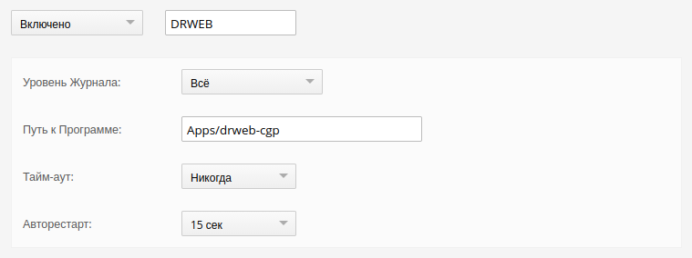
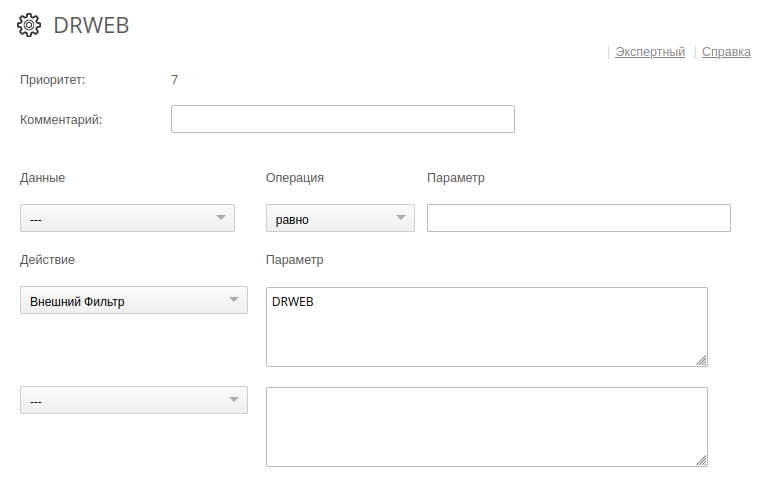

[](README.md) [](#)

## DrWeb helper for CommuniGate Pro 6.x, *версия 2.2.8*

### Введение

*Помощник* (внешний фильтр сообщений) **drweb-cgp** используется для проверки почтовых сообщений на вирусы. Он получает сообщения от *CommuniGate Pro* и передаёт их для обработки в *DrWeb*.<br/><br/>

### Возможности

* *Помощник* получает сообщение от *CommuniGate Pro* по протоколу *Интерфейса Внешнего Фильтра* и передаёт сообщение в *DrWeb*, используя протокол *CLAMD*.

* *Помощник* взаимодействует с *DrWeb* используя UNIX-сокет или TCP. При использовании UNIX-сокета задействуется механизм передачи файловых дескрипторов (FILDES), это исключает копирование данных сообщения между процессами хелпера и DrWeb.

> Важно: При использовании UNIX-сокета убедитесь, что пользователь, от имени которого запущен DrWeb, имеет права на чтение файлов в очереди CommuniGate Pro.

* *Помощник* даёт команду *CommuniGate Pro* удалить сообщение, если в нём обнаружен вирус.

* *Помощник* может оповещать отправителя сообщения о факте обнаружения вируса. Оповещение отправляется аутентифицированным пользователям или внешним отправителям, чей домен в *Envelope&nbsp;FROM* подтверждён подписью *DKIM* (подробности в конфигурационном файле).

> Проверка *DKIM* выполняется только при обнаружении вируса, только если оповещения разрешены.

* *Помощник* может выполнять пересылку копии сообщения с вирусом на указанные почтовые адреса.

* Если выполняется пересылка копии сообщения с вирусом, чтобы избежать двойной обработки или зацикливания, *Помощник* добавляет в обработанное сообщение заголовок *X-DrWeb-Seen:*.

### Установка

Конфигурационный файл *Помощника* [drweb-cgp.yml](drweb-cgp.yml) по умолчанию находится в той же директории, что и исполняемый файл **drweb-cgp**. При необходимости другое местоположение конфигурационного файла можно указать в командной строке. Возможные настройки *Помощника* подробно описаны в конфигурационном файле.

> Ниже показаны настройки *Помощника* и *Правила* в интерфейсе *CommuniGate Pro*.

##### Установки -> Общее -> Помощники


##### Установки -> Почта -> Правила -> DRWEB



#### Параметры командной строки

```
    Usage of drweb-cgp:
      -config string
            Path to configuration file (default "drweb-cgp.yml")
      -configdump
            Dump configuration and exit
      -configtest
            Test configuration syntax and exit
      -debug
            Enable debug logging
      -version
            Print version and exit
```

**config**

Указывает альтернативный конфигурационный файл.

**configdump**

Выводит конфигурационный файл в форматированном виде.

**configtest**

Проверяет синтаксическую корректность конфигурационного файла.

**debug**

В режиме -debug хелпер сохраняет копии проблемных файлов (которые не удалось прочитать или обработать) в директории *CommuniGate Pro* *BadFiles* для последующего анализа разработчиком.

</br>

### Лицензия

BSD License, [LICENSE.md](LICENSE.md)<br/><br/>

### Автор

Andrey Igoshin <<ai@vsu.ru>><br/><br/>

### Ссылки

* Репозиторий: <https://git.vsu.ru/ai/drweb-cgp>
* Сайт CommuniGate Pro: <https://communigatepro.ru>
* Протокол Помощника: <https://doc.communigatepro.ru/russian/development/Helpers.html#Filters>
* Сайт DrWeb: <https://www.drweb.ru/>
